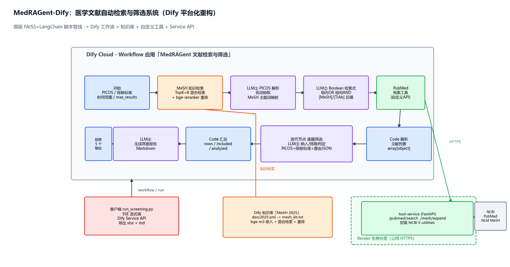

# MedRAGent-Dify

> 医学文献自动检索与筛选系统的 **Dify 平台化重构版**。基于原项目 [czczy/MedRAGent](https://github.com/czczy/MedRAGent)（FAISS + LangChain 纯 Python 脚本管线）重构为 **Dify Workflow + 原生知识库 + 自定义 API 工具** 的平台化实现——给定 PICOS 研究标准，自动完成 MeSH 主题词映射、PubMed 布尔检索式生成、文献检索与逐篇 LLM 筛选，输出筛查报告与结构化清单。



## ✨ 亮点

- **15 节点 Dify Workflow**：知识检索 → LLM PICOS 解析/MeSH 映射 → LLM 布尔检索式组装 → **Code 清洗检索式（剥离推理标签）** → **HTTP 节点直连 NCBI E-utilities**（esearch/efetch，无需部署服务）→ 代码解析 → **迭代节点逐篇筛选（4 路并行）** → 代码汇总 → 报告生成 → **Code 清洗报告**，全程可视化编排、单画布完成
- **Dify 原生知识库替代本地 FAISS**：MeSH 2026（desc2026.xml，3 万+ 医学主题词，按糖尿病相关分支 C18/C19/C20/C23/E01/F01 裁剪为 2,977 条）构建知识库，`BAAI/bge-large-en-v1.5` 稠密嵌入 + 混合检索 + `bge-reranker-v2-m3` 重排，替代原项目本地 `mesh_index.faiss` 索引（选型过程见 [SETUP.md §2](dify/SETUP.md#2-构建知识库)：bge-m3 的多向量表示在 Sandbox 50MB 向量配额下超限，故改用稠密模型 + 平台级混合检索）
- **外部 API 集成（HTTP 直连 + 可选自定义工具）**：工作流内 HTTP 请求节点直连 NCBI E-utilities（esearch JSON 端点 + MEDLINE 纯文本端点，零部署依赖、沙箱安全解析）；另附 FastAPI 工程化封装（限速/重试/指数退避，`tool-service/`，可部署 Render/HF Space 后注册为自定义工具，见 [dify/SETUP.md §7](dify/SETUP.md)）
- **Prompt Engineering**：4 组结构化提示词（名词抽取与 MeSH 映射 / 检索式组装规则 / PICOS 元素级纳入排除判定 / 报告生成），严格 JSON 输出 + 代码节点兜底解析（见 [dify/prompts.md](dify/prompts.md)）
- **一键复现**：DSL 文件导入 Dify + Render Blueprint 部署工具服务 + MeSH 语料生成脚本，见 [dify/SETUP.md](dify/SETUP.md)

## 🏗️ 架构与工作流

```
客户端 (run_screening.py, SSE)
   │ POST /workflows/run
   ▼
Dify Cloud Workflow
   开始(PICOS/排除标准/时间范围/max_results)
   → MeSH 知识检索(知识库, 混合检索+重排)
   → LLM① PICOS解析+MeSH映射 (deepseek-flash)
   → LLM② Boolean检索式组装 (deepseek-flash)
   → Code 清洗检索式 (剥离 `<think>` 推理标签/代码围栏)
   → HTTP esearch (NCBI esearch.fcgi, JSON)
   → Code 解析检索结果(total + PMID串)
   → HTTP efetch (NCBI efetch.fcgi, MEDLINE文本)
   → Code 解析文献列表(articles)
   → 迭代(4路并行): LLM③ 逐篇纳入/排除判定 (PICOS元素级理由 JSON)
   → Code 汇总(rows/included/analyzed)
   → LLM④ 生成筛查报告(Markdown)
   → Code 清洗报告 (剥离 `<think>` 推理标签)
   → 结束(report/rows/included/analyzed/total)
```

| 环节 | 原项目实现 | 本项目实现 |
|---|---|---|
| MeSH 主题词检索 | 本地 FAISS 索引 + bge-m3（自建） | **Dify 原生知识库**（托管向量库 + 混合检索 + 重排） |
| 同义词扩展 | NLM MeSH Lookup API | 知识库 Entry Terms 字段随检索注入 + `/mesh/expand` 工具 |
| 检索式组装 | Python 字符串拼接（suffix_rules） | LLM② 按显式组装规则生成（规则前置到提示词） |
| PubMed 检索 | `Bio.Entrez` 进程内调用 | **HTTP 节点直连 E-utilities**（零部署）；另附 FastAPI 封装可注册为自定义工具（可选升级） |
| 逐篇筛选 | Python for 循环 + LangChain 调用 | **Dify 迭代节点** + deepseek-flash |
| 结果解析兜底 | `json_repair` 库 | Code 节点（JSON 截断容错） |
| 报告输出 | 终端打印 + pandas 导出 xlsx | LLM④ Markdown 报告 + End 节点结构化输出 → 客户端导出 xlsx/md |

## 📁 仓库结构

```
MedRAGent-Dify/
├── data-prep/
│   └── mesh_to_kb.py        # MeSH desc2026.xml → Dify 知识库语料（支持树形分支裁剪）
├── tool-service/            # FastAPI 封装（可选升级：部署后注册 Dify 自定义工具）
│   ├── main.py              # GET /pubmed/search、GET /mesh/expand、GET /health
│   ├── openapi.json         # Dify 自定义工具注册 Schema
│   ├── hf-space/README.md   # Hugging Face Space（Docker）一键部署说明
│   └── Dockerfile / render.yaml / .env.example
├── dify/
│   ├── medragent-workflow.yml  # 工作流 DSL（导入即用，HTTP 直连 E-utilities）
│   ├── SETUP.md             # 从零复现手册（账号/知识库/画布/API 全流程）
│   └── prompts.md           # 4 组提示词全集与设计说明
├── client/
│   ├── run_screening.py     # SSE 流式调用 Dify Service API → 导出 xlsx + md
│   └── config.example.json  # 演示案例配置（Ramadan fasting × T1D）
├── docs/
│   ├── architecture.png
│   ├── platform-comparison.md  # Dify vs RAGFlow vs MaxKB 选型对比
│   └── baseline/            # 原版管线复现基线 + 一致性分析
└── resume/                  # 简历表述与面试问答要点
```

## 🚀 快速开始

1. **配模型**：Dify 插件市场装 DeepSeek + SiliconFlow，填入各自 API Key
2. **建知识库**：`python data-prep/mesh_to_kb.py --download` → 导入 Dify（自定义分隔符 `###`、`BAAI/bge-large-en-v1.5`、混合检索+bge-reranker-v2-m3 重排）
3. **导入工作流**：创建应用 → 导入 DSL → `dify/medragent-workflow.yml` → 重绑模型/知识库/迭代输入（无需部署任何服务）
4. **运行**：画布中用 [SETUP.md §4](dify/SETUP.md#4-运行验证演示案例) 的演示案例（Ramadan 禁食 × 青少年 1 型糖尿病）调试；或发布后 `python client/run_screening.py --config config.json` 端到端出报告
5. （可选升级）部署 `tool-service/` 到 Render / HF Space → 注册为自定义工具，恢复自定义工具架构

详细步骤、常见问题 → **[dify/SETUP.md](dify/SETUP.md)**

## 📊 演示案例

来自原项目 README 的真实系统综述案例（[doi:10.1186/s12902-025-01835-1](https://doi.org/10.1186/s12902-025-01835-1)）：

- **PICOS**：P=青少年 1 型糖尿病；I=Ramadan 禁食；O=血糖波动/DKA/HbA1c/体重变化；S=观察性研究
- **排除**：动物实验、个案报告、系统综述、meta 分析
- 管线自动生成形如 `("Diabetes Mellitus, Type 1"[MeSH Terms] OR "T1DM"[Title/Abstract]) AND ("Fasting"[MeSH Terms] OR "Hunger Strike"[MeSH Terms] ...) AND ("2001/05/01"[Date - Publication] : "2024/02/13"[Date - Publication])` 的检索式并逐篇判定
- **复现基线**（[docs/baseline](docs/baseline/)）：原版管线本地复跑，检索命中与原作者公开结果 PMID 100% 重合（44/44）；V3→V4.1-Flash 判定一致率 89.2%
- **Dify 版实跑**（[docs/dify-run](docs/dify-run/)）：Service API 端到端跑通，PubMed 命中 3,293，逐篇筛选 44 篇、建议纳入 10 篇；与原基线重合的 7 篇文献判定 **7/7 一致**。两版检索式口径不同（Dify 更宽），纳入总数不可直接比较，详见运行记录中的边界说明

## 📄 许可

MIT（沿用原项目许可）。MeSH 数据来自 NLM（公有领域）。

## 致谢

- [czczy/MedRAGent](https://github.com/czczy/MedRAGent)：PICOS 筛选方法学、提示词与检索管线设计
- [NCBI E-utilities](https://www.ncbi.nlm.nih.gov/books/NBK25499/)、[NLM MeSH](https://www.nlm.nih.gov/mesh/meshhome.html)、[Dify](https://github.com/langgenius/dify)
